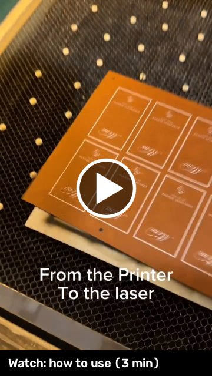
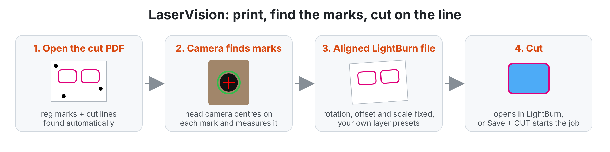
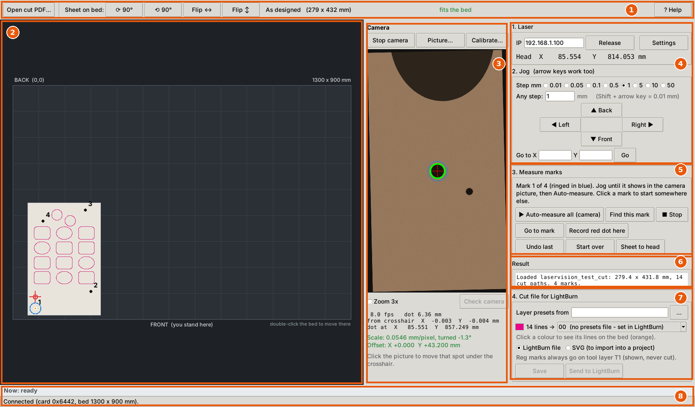
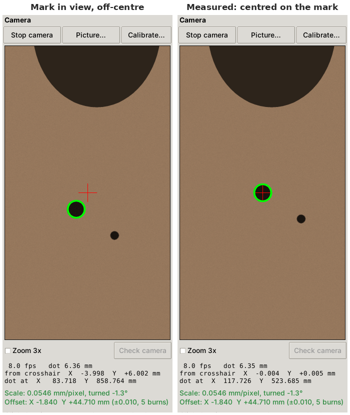
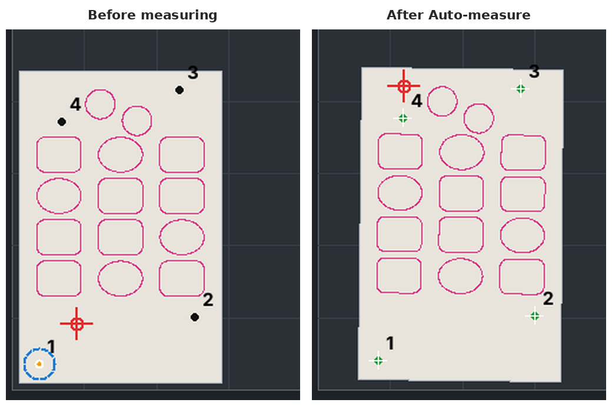
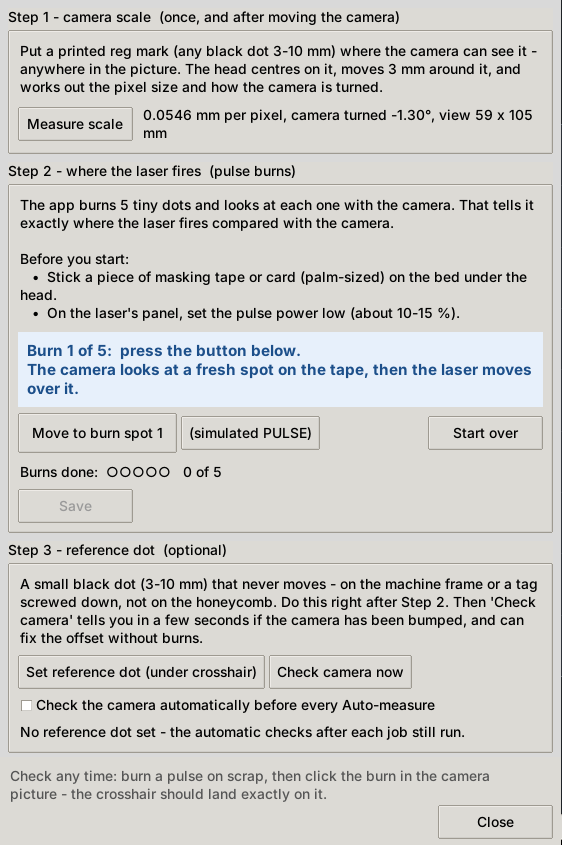

# LaserVision
LaserVision: camera print-and-cut for LightBurn + Ruida (Thunder) lasers

I print acrylic items, then cut them out on my Thunder Nova 51. Lining the cut up with the print by hand was slow and never quite exact. So I (AI DID IT!) built a small Windows app that uses a USB camera on the laser head to find the registration marks and line everything up for me.

## How-to video

Click the picture to watch: printed sheet to finished cut, step by step (3 min, no sound).

How it works

The customer's cut PDF has 3 or more small black dots (0.25 in), staggered so the sheet's orientation can't be mixed up. Open the PDF, and LaserVision finds the marks and cut lines automatically.
Lay the printed sheet on the bed, roughly straight. Jog the camera near the first mark and press Auto-measure. The head visits each mark, centres the camera on it and measures where it really is.
LaserVision works out how the sheet actually sits on the bed, including rotation, offset and any print scaling. It then writes an aligned LightBurn file that uses your own layer presets from an existing .lbrn2 file.
Send to LightBurn: the aligned file opens in LightBurn. Check it there and press Start.

What else it does

Calibration: done once. A quick scale test, then 5 low-power pulse burns tell it exactly where the beam fires compared with the camera.
Camera check: after every job it checks whether the camera has been bumped or the mount is sagging.
Cut file checks: it warns about doubled or overlapping cut lines (from traced or outlined strokes) and about prints that came out scaled.
Per-colour layers: each cut-line colour can go on its own layer, be left out, or be shown as a reference only.
Reg marks on T1: they're added on a tool layer, so you see them in LightBurn but they're never cut.
Shares the laser with LightBurn: LightBurn can stay open. LaserVision connects to the laser only when it needs it and lets go after 60 s idle (adjustable), so you never have to disconnect one program to use the other.
LightBurn 2.2 API: pair once in Settings, and LightBurn confirms every file LaserVision sends really opened. Older LightBurn versions still work, without the confirmation.
Help: a built-in manual (F1), plus a PDF install guide and user manual.

What you need: Windows 10/11, LightBurn, a Ruida controller on the network, a USB camera on the head (I use an Arducam B0205 at first, then switched to a endoscope), and Python (the install guide walks through it). LightBurn can stay open while you measure; LightBurn 2.2 or newer adds a confirmed hand-off.

Link to Endoscope Camera used: https://www.amazon.com/dp/B09B716SK3  
Link to the Arducam B0205 originally used: https://www.amazon.com/dp/B0829HZ3Q7  
Included in the files is the mount I used for the endoscope camera.  This was built for my Thunder 51 so you may need to make changes.

Also included: a mount for the **Thunder Bolt** ([ThunderBolt-StethoscopeMount.stl](ThunderBolt-StethoscopeMount.stl)), contributed by D. McHenry. Thank you!

On my machine the test sheet cut right on the printed lines for every shape. Happy to hear how it works on other machines.

Needed install instructions and manual are in the zip file.

## Download

Latest version: [LaserVision-0.8.0-full.zip](LaserVision-0.8.0-full.zip). What changed in each version: [CHANGELOG.md](CHANGELOG.md).

Older versions (kept in the repo history):
- [0.7.26](https://github.com/jkktech/laservision/raw/1af5681ba923792af9ac3fa2ff4a83779201b758/LaserVision-0.7.26-full.zip)
- [0.7.25](https://github.com/jkktech/laservision/raw/4b177826cc5befd7455c5102257e741ee717ccc2/LaserVision-0.7.25-full.zip)
- [0.7.23](https://github.com/jkktech/laservision/raw/44c5dd7d3f0d32b3e35109481dd154583082ce0a/LaserVision-0.7.23-full.zip)
- [0.7.20](https://github.com/jkktech/laservision/raw/44c5dd7d3f0d32b3e35109481dd154583082ce0a/LaserVision-0.7.20-full.zip)
- [0.7.10](https://github.com/jkktech/laservision/raw/44c5dd7d3f0d32b3e35109481dd154583082ce0a/LaserVision-0.7.10-full.zip)

I will not support this project as I don't have time.
You may suggest things, I will try and add them as I see fit for my needs.
ENJOY!
